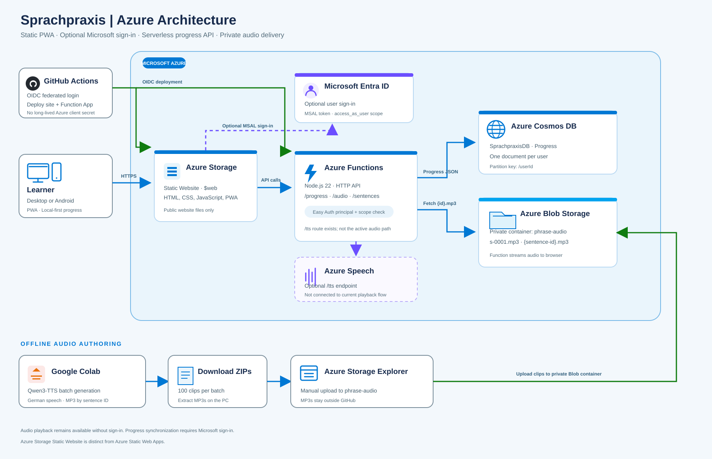

# Sprachpraxis — German Listening and Shadowing

A personal language-learning app for practicing common German sentences through audio, repetition, recall, and Brazilian Portuguese translations.

**Live app:** [sprachpraxisstorage.z1.web.core.windows.net](https://sprachpraxisstorage.z1.web.core.windows.net/)

## Project goal

I built Sprachpraxis to make deliberate listening and speaking practice easy to repeat: hear a sentence, reveal its translation, say it aloud, and revisit it until it feels natural. The current library contains **4,413 German sentence records**, organized into 35 micro-topics and expandable macro-topics, with Brazilian Portuguese translations.

This is also a hands-on Azure project. It combines static hosting, optional identity, serverless APIs, cloud data storage, private audio delivery, and automated deployment.

## Interview-ready summary

> I built Sprachpraxis to solve a learning problem I had myself: I wanted a simple way to listen to useful German sentences, check the Portuguese meaning, and repeat them until I could recall and pronounce them naturally. I started with a static HTML, CSS, and JavaScript app, then extended it with optional Microsoft sign-in, Azure Functions, Cosmos DB progress sync, and private Blob Storage for audio. The app still works without an account by keeping progress in the browser. I generate the German MP3s in batches with Qwen3-TTS in Google Colab and upload them to Blob Storage, where the API serves them by sentence ID. The hardest parts were making authentication optional while protecting per-user progress, keeping sentence and audio IDs stable across the app and storage, and fitting background playback into browser and Android limits. The project gave me practical experience with Azure identity, OIDC deployments, RBAC, Functions, Cosmos DB, Blob Storage, and the cost and usability trade-offs of a serverless design.

## Architecture

### Request and data flow

1. The browser loads the PWA files from the Azure Storage Static Website `$web` container.
2. The app can be used without signing in. Local progress is stored in `localStorage`.
3. Microsoft Entra ID sign-in is optional. When signed in, the frontend obtains an API token and sends progress to Azure Functions.
4. The progress function validates the authenticated principal and delegated scope, then merges progress into the Cosmos DB `Progress` container, partitioned by `userId`.
5. Audio MP3s are kept in the private `phrase-audio` Blob container. The app requests a clip by sentence ID; the Function App reads `{id}.mp3` and returns it to the browser. If the clip is missing, the browser speech engine is the fallback.
6. GitHub Actions publishes the static site and Function App using Microsoft Entra workload identity federation (OIDC), without a long-lived Azure client secret.

## Features

- Shadowing mode: listen to German and reveal the Portuguese translation.
- Active recall mode: see the Portuguese translation first, then reveal the German sentence.
- Repeat tracking, spaced review dates, and a synchronized five-star pronunciation rating.
- Filters for due reviews and pronunciation ratings.
- Macro-topics that expand into smaller learning islands.
- Optional Microsoft sign-in for progress synchronization across devices.
- Local-first use without an account.
- PWA shell caching and Media Session controls for supported browsers.
- 4,413 sentence records with stable IDs used to match text, progress, and audio.

## Technology

| Area | Technology |
| --- | --- |
| Frontend | HTML, CSS, JavaScript |
| Static hosting | Azure Storage Static Website (`$web`) |
| Authentication | Microsoft Entra ID, MSAL Browser |
| API | Azure Functions v4, Node.js 22 |
| Progress database | Azure Cosmos DB for NoSQL |
| Audio storage | Private Azure Blob Storage |
| Audio generation | Qwen3-TTS in Google Colab; MP3s uploaded with Azure Storage Explorer |
| CI/CD | GitHub Actions, Azure CLI, Azure Functions action, OIDC federation |
| PWA and media | Web App Manifest, service worker, Media Session API |

## Challenges and design decisions

### 1. Static hosting with authenticated cloud features

**Challenge:** Azure Storage Static Website hosting is intentionally simple and does not provide the integrated authentication and API routing available in Azure Static Web Apps.

**Decision:** Keep the frontend on Azure Storage and add an Azure Functions backend. Microsoft sign-in is optional, and the browser keeps a local copy of progress so the basic study experience remains available without a login.

**Trade-off:** This keeps the static hosting model straightforward, but requires separate configuration for MSAL, API CORS, Function App authentication, and the frontend API URL.

### 2. User-specific progress synchronization

**Challenge:** Progress must follow the signed-in user across devices without mixing data between users.

**Decision:** The progress API validates the Easy Auth principal and the delegated `access_as_user` scope. It uses the user's object ID as the Cosmos DB item and partition key, and merges repetitions, review timestamps, ratings, and listening totals.

**Trade-off:** Cloud synchronization depends on Entra, the Function App, and Cosmos DB. Local browser storage remains the fallback when a user is offline or chooses not to sign in.

### 3. Private audio delivery

**Challenge:** Audio should not be stored in the public website container, and the browser should not need a Storage account key.

**Decision:** MP3s live in the private `phrase-audio` container. The public audio endpoint accepts a validated sentence ID and streams the matching file through the Function App. Blob credentials stay in Function App settings.

**Trade-off:** The API adds a network hop and audio egress through the Function App. In return, the container remains private and storage credentials stay server-side.

### 4. Batch-generated speech instead of live synthesis

**Challenge:** Generating every clip at playback time would add latency and repeated synthesis cost.

**Decision:** Qwen3-TTS generates MP3s in batches in Google Colab. Files use the sentence IDs as names, are downloaded to the PC, and are uploaded to Blob Storage with Azure Storage Explorer. The Function App also contains an Azure Speech endpoint, but it is not the active audio path in the app.

**Trade-off:** This avoids live synthesis for every repetition and gives the app reusable clips, but generating and uploading new sentences is a manual batch workflow. The browser's speech synthesis remains a fallback for missing clips.

### 5. Android background audio

**Challenge:** Mobile browsers may pause a web page when it is backgrounded or the screen is locked.

**Decision:** The app uses a persistent audio element, PWA shell caching, and Media Session metadata and controls.

**Trade-off:** These improve lock-screen playback on supported Android browsers but cannot guarantee uninterrupted playback like a native Android foreground media service.

### 6. Cost and operational simplicity

**Challenge:** A cloud database enables cross-device progress, but provisioned throughput can have baseline cost even when usage is light.

**Decision:** Cosmos DB stores progress as JSON documents, matching the app's existing data shape. The account was opted into the available free tier.

**Trade-off:** The free tier and actual bill depend on account eligibility, capacity, and usage. Cosmos DB is more capable than local storage but introduces an Azure resource to monitor and maintain.

## Deployment

Two GitHub Actions workflows run from the `main` branch:

- `.github/workflows/deploy-storage.yml` uploads the site files to the `$web` container.
- `.github/workflows/deploy-functions.yml` deploys the `api/` package to the Function App.

Both workflows use OIDC federation to authenticate to Azure. The required federated identity and Azure RBAC assignments are configured in Azure; deployment credentials are not embedded in the source files.

Azure resources are currently configured through the Azure portal rather than provisioned from Infrastructure as Code. This made the project easier to build incrementally, but means a fresh environment is not yet reproducible from a single template.

## Configuration and security

- `auth-config.js` contains public Entra application identifiers and the API URL. These values are client-side configuration, not client secrets.
- Cosmos DB keys and the Blob connection string are configured as Function App application settings, not committed to the repository.
- The progress endpoint requires an authenticated principal with the expected delegated scope.
- The Blob container is private. The app accesses clips through the API.
- The audio endpoint is intentionally available without sign-in so that audio playback works for anonymous users.
- GitHub Actions uses federated identity rather than a long-lived Azure client secret.
- Do not commit `api/local.settings.json`, account keys, SAS tokens, connection strings, or Speech keys.

## Lessons learned

- A static website can remain useful without an account while still supporting cloud synchronization for users who opt in.
- Frontend identity, API identity validation, and storage authorization are separate layers and must be configured deliberately.
- Stable IDs are the contract that connects sentence content, ratings, progress, and audio files.
- Private Blob storage does not require exposing storage credentials to the browser; a small API can mediate access.
- Batch generation is a practical alternative to live TTS when clips are reused, but it shifts work to an offline generation and upload process.
- OIDC reduces the need for long-lived deployment secrets, while still requiring correct federation and least-privilege RBAC.
- Browser media APIs help with background playback, but mobile operating systems retain control over suspension.
- Cost, simplicity, and user experience need to be considered together when selecting storage and database services.

## Current limitations and next steps

- Azure resources are not yet described as Bicep or Terraform.
- There is no automated application test suite in the current repository; deployments are handled by GitHub Actions.
- Qwen-generated audio is uploaded manually; the Azure Speech route is not connected to the frontend's current playback flow.
- Background playback varies by browser and Android battery settings.
- Monitor Cosmos DB throughput and storage costs as the app grows.

---

Built by Thiago Sommerfeld as a personal German-learning and Azure cloud engineering project.
